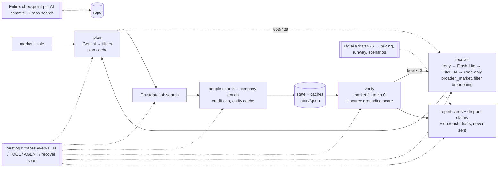

# neathack-agent

## For judges

**Hiring-signal scout** is for sales and recruiting reps who need to know *who is hiring right now, for what, and who owns the hire*. You give it a market ("Series A AI infra Bay Area") and a role ("backend engineer"). It returns companies with live openings, their decision-makers (LinkedIn), headcount and funding data, and a short first email per person. Every claim cites its Crustdata source, and a grounded-claims score is shown. It recovers on its own from LLM outages, empty searches and off-market results. A deep report costs about $1.38 to make (cfo.ai-modelled price $12, 88.5% margin).



**Quickstart**
```bash
python3 -m venv .venv && source .venv/bin/activate
pip install -r requirements.txt
cp .env.example .env   # add NEATLOGS_API_KEY, CRUSTDATA_API_KEY, GEMINI_API_KEY (LITELLM_API_KEY optional)
python app.py          # open http://localhost:8000 (tick Dry run for mock data / 0 credits)
```

**Proof:** [docs/EVIDENCE.md](docs/EVIDENCE.md) (before/after, failures and recoveries, neatlogs detections, Entire checkpoints, cfo.ai results) · [neatlogs recovery trace](https://app.neatlogs.com/traces/0f5c9601c4dd3e2553b89404437cdf41?scrollTo=e4b43864372824dd&orgId=73ac3bcd-77b2-4747-9c72-40b38d04d057&projectId=43529309-226a-4089-ae78-c0344ee7c99a) · [neatlogs detections](docs/EVIDENCE.md#neatlogs-tracing--detections) · [docs/demo-script.md](docs/demo-script.md) · [docs/unit-economics.md](docs/unit-economics.md)


neathack-agent is a hiring-signal scout built for neatHack 2026. Give it a market (e.g. Series A–B AI infra in the Bay Area) and a role, and it returns a ranked list of companies hiring for that role, key decision-makers, and a source for every claim. Built with Crustdata (data), neatlogs (tracing), Entire (checkpoints), and cfo.ai (unit economics).

## How it works

`plan` (Gemini turns the market + role into search filters) → `tools` (Crustdata Job Search + Person Search, capped at 10 jobs and 5 people × 3 companies) → `state` (saved to `runs/<timestamp>.json`) → `recover` (broadens filters on empty results or errors) → `verify` (Gemini plus a code check drop any claim without a Crustdata source URL) → markdown report in `runs/<timestamp>.md`. Every LLM call and tool call is traced in neatlogs.

## Run it

Put your keys in a `.env` file in the repo root (see `.env.example`): `NEATLOGS_API_KEY`, `CRUSTDATA_API_KEY`, `GEMINI_API_KEY`.

```
python3 -m venv .venv && source .venv/bin/activate && pip install -r requirements.txt && set -a && source .env && set +a && python -m neatlogs doctor --probe && python agent.py --dry-run "Series A AI infra Bay Area" "backend engineer"
```

`--dry-run` uses mock company data, so it spends no Crustdata credits (Gemini and neatlogs still run). Drop the flag for a live run (about 0.3–1 Crustdata credits). Crustdata responses are cached in `runs/crustdata_cache.json`, so repeating the same search costs 0 credits. Gemini calls retry with backoff (5s/15s/30s) on 429/5xx, then fall back to `GEMINI_FALLBACK_MODEL`; if verification still fails, the report is built from a code-only source check and marked "LLM verify unavailable".

### Deep mode and credit cap

```
python agent.py --deep "Series A AI infra Bay Area" "backend engineer"
```

`--deep` also calls Crustdata `/company/enrich` (headcount, 6-month/YoY headcount growth, total funding, last round) for the top `--deep-n` companies (default 5, about 2 credits each), shown in the report with the source. Every run prints estimated and actual Crustdata credits (actual comes from the `X-Credits-Used` header) and saves them as `credits_spent` in `runs/<timestamp>.json`. `--max-credits` (default 15) skips any paid call that would push the estimate over the cap. Decision-makers are looked up by the company's Crustdata ID first, then its website domain, then its name.

### Caching, --replan and --no-spend

- The plan Gemini makes for a market + role (ignoring case and extra spaces) is saved in `runs/plan_cache.json` and reused on reruns, together with its job-date window. That keeps the Crustdata requests identical, so they come from `runs/crustdata_cache.json`. Use `--replan` to force a new plan.
- Decision-makers and `--deep` company data are also cached per Crustdata company ID in `runs/entity_cache.json`, so a company found under a different plan is not paid for again.
- `--no-spend` uses cached data only and skips every paid Crustdata call that is not cached (0 credits).
- Each run prints cache hits, paid calls and calls skipped by `--no-spend`, and saves them as `cache_stats` in `runs/<timestamp>.json`.

## Demo

```bash
pip install -r requirements.txt
python app.py
```

Open [http://localhost:8000](http://localhost:8000).

For rehearsal (0 Crustdata credits, shows recover/fallback on camera): check **No-spend** and **Simulate Gemini failure**, then run. That forces fake 503s on the first Gemini calls so retries and the fallback model appear in the live timeline (`SIMULATED` labels).

Also on the form: market, role, **Deep**, **Dry run** (mock data), **Replan**. The UI streams the agent loop over SSE, renders company cards (jobs, decision-makers, firmographics), a cost meter, outreach drafts (copy only — nothing is sent), and a link to neatlogs traces.

CLI equivalent: `python agent.py "<market>" "<role>" --no-spend --simulate-failures 2`.

### LLM provider fallback chain

`GEMINI_MODEL` → `GEMINI_FALLBACK_MODEL` → optional neatHack **LiteLLM** proxy (OpenAI-compatible; set `LITELLM_API_KEY`, default `LITELLM_BASE_URL=https://litellm.vision.aivar.app/v1`, `LITELLM_MODEL=claude-haiku`; also nova-micro/lite/pro, nova-2-lite, claude-sonnet-4.6, claude-opus-4.6) → code-only verify. Each switch is logged as `[recover] provider_switch` and traced in neatlogs. The LiteLLM key has a shared $20 / 30-day team budget.
